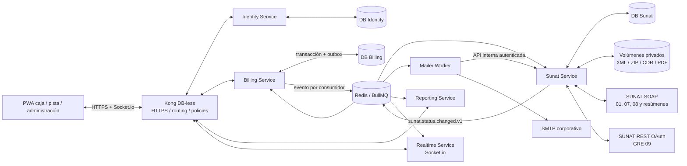

# Sistema de Facturación para Grifo San José basado en FactuEz

Blueprint de arquitectura para **GRIFO SAN JOSE S.R.L.**, RUC
**20450819230**, y otros emisores configurables. Sistema privado multi-emisor,
local/on-premise y accesible únicamente desde la intranet. Corrección: 2026-10-01.

Cada sede tiene un RUC configurable; 21+1 es una distribución prevista, no una
restricción. La decisión actual y migración están en [MULTI_RUC.md](MULTI_RUC.md).

## 1. Decisión arquitectónica

Se implementará un **monorepo de microservicios**. Cada servicio NestJS será un
proceso, imagen y unidad de despliegue independiente, con API/consumidores y
persistencia bajo su propiedad exclusiva. El monorepo comparte tooling,
contratos de mensajes y librerías puras; no comparte lógica de aplicación,
repositorios ni Prisma Client.

Microservicios desplegables:

- `kong`: gateway perimetral DB-less. Termina TLS, aplica CORS, límites,
  correlation-id y enruta; no contiene lógica de negocio.
- `identity-service`: usuarios, credenciales locales, sesiones y roles.
- `billing-service`: empresa fiscal pública, puntos, turnos, catálogo, clientes,
  series, correlativos, documentos y resúmenes diarios.
- `sunat-service`: credenciales/certificado, UBL, firma, ZIP, SOAP/REST, tickets,
  CDR y artefactos fiscales.
- `mailer-worker`: SMTP, políticas de entrega y trazabilidad de correos.
- `reporting-service`: proyecciones de lectura, dashboard y exportaciones.
- `realtime-service`: Socket.io; consume eventos y mantiene rooms por usuario,
  rol y punto de emisión.

Se usa un único contenedor PostgreSQL por simplicidad on-premise, pero contiene
bases lógicas separadas (`factuez_identity`, `factuez_billing`,
`factuez_sunat`, `factuez_mailer`, `factuez_reporting`). Un servicio no puede
leer tablas ajenas ni ejecutar joins entre bounded contexts. Cada base tiene un
rol y contraseña diferentes; las credenciales de administrador PostgreSQL no se
montan en ningún microservicio.

Decisiones no negociables:

- Una sola empresa emisora; no se añade `tenantId`. `billing-service` es dueño
  de su configuración fiscal pública y publica snapshots versionados.
- Cada base de servicio es su fuente de verdad. Redis transporta comandos y
  eventos, pero una pérdida de Redis no puede perder un comprobante: cada
  productor usa Outbox y cada consumidor Inbox.
- El número se asigna y el documento se persiste en una sola transacción.
- Después de `ISSUED`, el snapshot fiscal es inmutable. Una corrección se hace
  mediante nota o baja conforme al caso, nunca editando el original.
- `DocumentStatus` y `SunatStatus` son estados distintos. “Emitido localmente”
  no equivale a “aceptado por SUNAT”.
- El navegador puede trabajar sin Internet público, pero necesita llegar al
  servidor FactuEz de la intranet para emitir. No se asignan correlativos en
  IndexedDB.
- Ninguna credencial, certificado, XML, CDR o conexión de base de datos llega
  al bundle Next.js ni a una variable `NEXT_PUBLIC_*`.

## 2. Estructura del monorepo

Se propone PNPM Workspaces + Turborepo:

```text
sistema/
├─ apps/
│  ├─ web-pwa/                         # Next.js App Router, PWA, caja/pista/admin
│  │  ├─ app/(auth)/
│  │  ├─ app/(pos)/emitir/
│  │  ├─ app/(admin)/configuracion/
│  │  ├─ app/(admin)/reportes/
│  │  ├─ components/
│  │  └─ public/manifest.webmanifest
├─ services/
│  ├─ identity-service/                # Usuarios, RBAC, login y sesiones
│  │  ├─ prisma/schema.prisma
│  │  └─ src/{domain,application,infrastructure}/
│  ├─ billing-service/                 # Emisión, series, turnos, documentos, resúmenes
│  │  ├─ prisma/schema.prisma
│  │  └─ src/{domain,application,infrastructure}/
│  ├─ sunat-service/                   # UBL, firma, SOAP/REST, tickets, CDR, artefactos
│  │  ├─ prisma/schema.prisma
│  │  └─ src/{domain,application,infrastructure}/
│  ├─ mailer-worker/                   # SMTP y entregas; base propia
│  │  ├─ prisma/schema.prisma
│  │  └─ src/{application,infrastructure}/
│  ├─ reporting-service/               # Read model, dashboard, Excel/PDF
│  │  ├─ prisma/schema.prisma
│  │  └─ src/{projections,queries,exports}/
│  └─ realtime-service/                # Socket.io y rooms; sin persistencia fiscal
│     └─ src/{auth,consumers,gateways}/
├─ packages/
│  ├─ database/                        # Tooling común; nunca schema/cliente compartido
│  ├─ contracts/                       # DTO/eventos versionados; sin Nest/Prisma
│  ├─ sunat-core/                      # Cálculos, catálogos y builders UBL puros
│  ├─ validation/                      # Zod y reglas de negocio
│  ├─ pdf-renderer/                    # Ticket 80 mm, A4, QR y hash
│  ├─ config/                          # Configuración tipada y lectura *_FILE
│  ├─ observability/                   # logs, métricas, correlation-id
│  ├─ ui/                              # Shadcn/Radix compartido
│  ├─ eslint-config/
│  └─ typescript-config/
├─ infra/
│  ├─ kong/kong.yml                    # Gateway declarativo DB-less
│  ├─ prometheus/
│  ├─ grafana/
│  └─ backup/
├─ secrets/                            # Fuera de Git; sólo README en el repo
├─ docker-compose.yml
├─ pnpm-workspace.yaml
├─ turbo.json
└─ .env.example
```

Reglas de dependencia:

```text
web-pwa -> Kong -> API interna del microservicio dueño
microservicio -> su application/domain -> su infrastructure/Prisma
productor outbox -> cola dedicada por consumidor -> inbox del consumidor
contracts -X-> NestJS, Prisma, repositorios o reglas de negocio
servicio A -X-> Prisma Client/base de servicio B
web-pwa/Kong/realtime-service -X-> Prisma y secretos fiscales
```

## 3. Componentes y flujo de datos



### Flujo de emisión 01/07/08

1. La PWA envía `POST /api/v1/documents` a Kong con `Idempotency-Key`. Kong
   aplica políticas de borde y enruta a `billing-service`; el servicio valida
   la firma JWT y los permisos de dominio.
2. `billing-service` valida cliente, serie, turno, unidades, afectación,
   redondeos y totales. Todos los importes se calculan allí con decimal.
3. En una transacción de **su propia base** incrementa `SeriesCounter`, inserta
   documento/snapshot y agrega `billing.document-issued.v1` a su Outbox.
4. Su relay crea una copia del evento en cada cola suscriptora
   (`sunat.inbox`, `reporting.inbox`, `realtime.inbox`). Cada consumidor registra
   `eventId` en Inbox antes de procesar.
5. `sunat-service` construye UBL 2.1, valida XSD/reglas, firma XMLDSig,
   calcula `DigestValue`, crea el ZIP y conserva hashes SHA-256.
6. El adaptador SOAP ejecuta `sendBill`; `sunat-service` guarda intento/CDR sólo
   en `factuez_sunat` y publica `sunat.document-status-changed.v1`.
7. `billing-service` consume ese evento y actualiza su proyección de estado;
   `reporting-service` actualiza sus lecturas y `realtime-service` lo
   retransmite por WebSocket a través de Kong. No hay escrituras cruzadas.

Las notas de crédito/débito guardan una `DocumentReference` obligatoria y su
código/motivo SUNAT. La familia de serie (`F...` o `B...`) debe corresponder al
documento afectado.

### Flujo de boletas 03

La boleta se firma y conserva individualmente, pero en SEE del Contribuyente se
informa mediante **Resumen Diario de boletas y notas asociadas**. Por ello:

1. La boleta queda `ISSUED + SUMMARY_PENDING` y puede imprimirse.
2. Un job programado por fecha Lima, además de una acción manual de cierre,
   crea `DailySummary` sin incluir dos veces la misma boleta.
3. El resumen se firma y se envía por SOAP `sendSummary`; SUNAT devuelve ticket.
4. `sunat.poll.ticket` consulta `getStatus` con backoff hasta obtener CDR.
5. El CDR del resumen se vincula a todos sus documentos y se notifican sus
   estados. Un resumen rechazado se corrige con una nueva secuencia; no se
   sobrescribe el intento anterior.

Esta pieza es obligatoria en el diseño aunque no apareciera en el alcance
inicial. SUNAT describe que las boletas y notas asociadas se informan mediante
Resumen Diario.

### Flujo GRE 09

1. Se valida conductor, vehículo, modalidad, motivo, peso, fecha de traslado,
   origen/destino, ubigeos y bienes.
2. Se construye/firma el XML de GRE y se genera ZIP + hash SHA-256 del ZIP.
3. El adaptador obtiene token con el grant documentado por SUNAT:
   `client_id`, `client_secret`, `username = RUC + usuario SOL`, clave SOL y
   scope GRE. El token se guarda en Redis con TTL menor a su expiración.
4. La API REST recibe nombre, ZIP Base64 y hash, y devuelve `numTicket`.
5. Un job separado consulta el ticket hasta recibir CDR o error definitivo.

Las URI GRE se inyectan por ambiente; no se compilan en el código porque el
manual oficial señala que son referenciales. Producción sólo se habilita tras
probar token, permiso `/v1/contribuyente/gem` y envío controlado.

## 4. Estados e idempotencia

Estado de negocio:

- `DRAFT`: editable, sin correlativo fiscal definitivo.
- `ISSUED`: numerado e inmutable.
- `CANCELLED`: borrador cancelado o cierre administrativo; no representa por sí
  mismo una baja tributaria.

Estado SUNAT:

```text
PENDING -> QUEUED -> BUILDING -> SIGNED -> SUBMITTED
                                          ├-> PROCESSING -> ACCEPTED
                                          ├-> ACCEPTED_WITH_OBSERVATIONS
                                          ├-> REJECTED
                                          └-> RETRYABLE_ERROR -> QUEUED
```

`REJECTED` y errores de validación 4xx/422 son definitivos hasta intervención.
Timeout, DNS, 429, 5xx y 503 son reintentables. Ante un timeout ambiguo después
del envío SOAP no se envía a ciegas: primero se consulta CDR/estado por el
identificador; el registro `SunatSubmission` conserva cada intento.

Capas de idempotencia:

- `Idempotency-Key` obligatorio en comandos de emisión.
- `@@unique([originSystem, originId])` para migración/integración.
- `@@unique([type, series, number])` en PostgreSQL.
- `BullMQ.jobId = environment:ruc:type:series:number:operation`.
- Un `SunatSubmission.idempotencyKey` por operación/intento.
- Outbox transaccional: jamás “guardar después de publicar”.

Asignación atómica del correlativo, dentro de la misma transacción que inserta
el documento:

```sql
UPDATE "SeriesCounter"
SET "nextNumber" = "nextNumber" + 1, "updatedAt" = now()
WHERE id = $1 AND active = true
RETURNING "nextNumber" - 1 AS allocated_number;
```

Un número emitido no se reutiliza. Las series se validan al configurar:
factura `F...`, boleta `B...`, GRE `T...`, cuatro caracteres; notas `F...` o
`B...` según el comprobante afectado.

## 5. Modelo de datos

No existe un schema Prisma global. Cada servicio mantiene y migra el suyo:

- `identity-service`: `User`, `RefreshSession`, `AuditLog`, Outbox/Inbox.
- `billing-service`: `CompanySettings`, `EmissionPoint`, `Shift`,
  `SeriesCounter`, `FuelProduct`, `Customer`, `Document`, ítems, impuestos,
  referencias, GRE y `DailySummary`.
- `sunat-service`: `IssuerProjection`, `SunatCredentials`, `SunatSubmission`,
  `CdrLog`, `DocumentArtifact`, Outbox/Inbox.
- `mailer-worker`: `SmtpSettings`, `EmailDelivery`, Inbox.
- `reporting-service`: proyecciones desnormalizadas de ventas/estado/turno e
  Inbox. Sus tablas pueden reconstruirse reproduciendo eventos.

Las relaciones entre servicios son IDs opacos, no foreign keys. Por ejemplo,
`sunat-service.documentId` identifica un documento de Billing pero no declara
una relación Prisma hacia él.

Los datos del cliente, producto, impuestos y emisor se duplican deliberadamente
en `immutableSnapshot`: cambiar el catálogo mañana no puede alterar una
representación de ayer.

Además de las claves Prisma, las migraciones del servicio dueño añaden:

- una fila de `CompanySettings` por RUC y credenciales SUNAT por RUC/entorno;
  SMTP puede ser compartido corporativamente, conservando el emisor de cada envío;
- series, números y resúmenes separados por emisor; FKs compuestas con RESTRICT
  impiden trasladar el historial al cambiar una configuración de sede;
- RUC con 11 dígitos y ubigeo con 6;
- importes/cantidades no negativos y `nextNumber > 0`;
- exactamente uno entre `documentId` y `dailySummaryId` en la base SUNAT;
- `DESPATCH_ADVICE` requiere `DespatchAdviceDetails` (regla diferida en servicio
  o trigger);
- timestamps y auditoría inmutables para entidades fiscales aceptadas.

El catálogo inicial debe incluir Gasolina Regular, Gasolina Premium, Diesel B5,
GLP, GNV, lubricantes y aditivos, pero unidades y afectaciones son datos
configurables. El código UNSPSC SUNAT no debe inventarse: se carga sólo si está
confirmado para el producto.

## 6. Criptografía, certificados y artefactos

Patrón de referencia:

- `XmlSignerService` carga `.p12/.pfx`, extrae clave/certificado sólo en memoria,
  inserta firma XMLDSig en `ext:ExtensionContent` y devuelve `DigestValue`.
- `SunatSoapAdapter` encapsula WSDL, WS-Security UsernameToken, `sendBill`,
  `sendSummary` y `getStatus`.
- `SunatGreRestAdapter` encapsula token, envío y consulta de ticket GRE.
- Los builders UBL no conocen transporte ni secretos.

Los algoritmos XMLDSig se definen mediante un `XmlSignatureProfile` versionado.
No deben elegirse por preferencia criptográfica aislada: el perfil final se
congela con los XSD y reglas SUNAT vigentes, casos dorados y homologación.

Secretos:

- `app_master_key` vive como Docker secret y nunca en PostgreSQL.
- Contraseña PKCS#12, usuario/clave SOL, client ID/secret GRE y SMTP se cifran
  con AES-256-GCM usando una clave de datos aleatoria y versión de clave.
- El certificado se valida al cargar: RUC/razón social, clave privada, fechas,
  huella y posibilidad real de firma/verificación.
- Se alerta 60, 30, 15, 7 y 1 día antes de expirar.
- La rotación conserva la clave anterior sólo para descifrar historial durante
  la transición; nunca vuelve a firmar documentos ya emitidos.

Artefactos:

```text
/data/artifacts/20450819230/YYYY/MM/{tipo}/{serie-numero}/
  unsigned.xml
  signed.xml
  submission.zip
  cdr.zip
  cdr.xml
  ticket-80mm.pdf
  a4.pdf
  delivery.zip
```

Cada escritura usa archivo temporal + `fsync` + rename atómico y registra
tamaño/SHA-256. `delivery.zip` es distinto del ZIP enviado a SUNAT y contiene
XML firmado + CDR para el cliente. El “hash” impreso es el `DigestValue` de la
firma; no se confunde con el SHA-256 del archivo/ZIP.

No se descomprime un ZIP sin límites de cantidad, tamaño total, rutas relativas
y extensión (protección Zip Slip/Zip Bomb).

## 7. Contratos HTTP y tiempo real

Kong publica las rutas y las asocia directamente con el servicio dueño:

```text
POST   /api/v1/auth/login
GET    /api/v1/setup/status
POST   /api/v1/setup/company
POST   /api/v1/setup/certificate
POST   /api/v1/setup/test-sunat-credentials
PUT    /api/v1/setup/environment

POST   /api/v1/shifts
POST   /api/v1/shifts/:id/close
GET    /api/v1/products
POST   /api/v1/documents
GET    /api/v1/documents/:id
POST   /api/v1/documents/:id/retry
POST   /api/v1/documents/:id/email
GET    /api/v1/documents/:id/artifacts/:kind
POST   /api/v1/daily-summaries
GET    /api/v1/reports/sales.xlsx
GET    /api/v1/reports/sales.pdf
GET    /api/v1/dashboard
```

| Prefijo público | Upstream |
|---|---|
| `/api/v1/auth`, `/api/v1/users` | `identity-service` |
| `/api/v1/setup/company`, `/api/v1/documents`, `/api/v1/products`, `/api/v1/shifts`, `/api/v1/daily-summaries` | `billing-service` |
| `/api/v1/setup/certificate`, `/api/v1/setup/sunat`, `/api/v1/fiscal-artifacts` | `sunat-service` |
| `/api/v1/reports`, `/api/v1/dashboard` | `reporting-service` |
| `/socket.io` | `realtime-service` |
| `/` | `web-pwa` |

Kong opera DB-less con configuración declarativa versionada. Aplica
`correlation-id`, CORS, límites de tamaño, rate limiting y métricas. JWT es
emitido por `identity-service`; cada microservicio valida firma/audience y sus
propios permisos para que Kong no sea el único control de seguridad.

Se fija la imagen OSS `kong:3.9.3` (sin `latest`). Para este despliegue de un
solo nodo, DB-less evita agregar otra base de control: `kong.yml` es la fuente
de verdad, el Admin API queda apagado y el rate limiting usa política local.

La API devuelve `202 Accepted` cuando el documento fue emitido localmente y la
validación SUNAT sigue asíncrona. La respuesta incluye `documentId`, número,
`documentStatus`, `sunatStatus` y `statusUrl`.

Eventos Socket.io versionados:

```text
document.status.changed.v1
document.cdr.received.v1
sunat.connectivity.changed.v1
queue.alert.v1
dashboard.metrics.changed.v1
certificate.expiration.warning.v1
```

Los sockets se autentican, se unen a rooms por punto/rol y reciben sólo IDs y
datos de presentación. El cliente siempre puede reconsultar REST; WebSocket no
es la fuente de verdad.

## 8. PWA y experiencia de pista

- Service worker precarga app shell, íconos, fuentes y catálogo de lectura.
- Las mutaciones fiscales no se almacenan como “background sync” ciego.
- Si hay intranet pero no Internet, la emisión continúa en el servidor y queda
  en cola SUNAT con estado visible en color/texto/ícono.
- Si no hay intranet, se bloquea la emisión fiscal para evitar correlativos
  duplicados. Un modo de bloques reservados sería otro proyecto con controles
  operativos y conciliación explícita.
- Formularios optimizados para teclado, lector, pantalla táctil y selección
  rápida de combustible/unidad.
- Ticket con CSS/renderer para 80 mm y A4 por separado; no se escala A4 a 80 mm.
- Impresión silenciosa requiere política kiosk del navegador o un agente local
  de impresión. La PWA web estándar mostrará diálogo de impresión.
- El QR se genera desde el snapshot fiscal conforme al formato SUNAT vigente y
  ambos PDFs muestran estado (`PENDIENTE SUNAT`, `ACEPTADO`, etc.) sin inducir
  a error.

## 9. Contingencia y reintentos

Hay dos conceptos distintos:

1. **Caída de conectividad/SUNAT:** FactuEz genera, firma, imprime como pendiente
   y reintenta dentro del plazo aplicable. El documento no se etiqueta como CDR
   aceptado antes de recibirlo.
2. **Comprobante físico de contingencia/concurrencia:** es un procedimiento
   tributario diferente, con formatos autorizados y resumen específico. No debe
   simularse imprimiendo un CPE pendiente. Se implementa como fase separada si
   el contador confirma que aplica al emisor.

Política inicial de BullMQ: backoff exponencial con jitter (30 s, 2 min, 10 min,
30 min, 2 h), circuit breaker por endpoint, límite de concurrencia bajo y
alertas al acercarse al plazo. El entorno Beta no se usa para estrés, de acuerdo
con la advertencia SUNAT.

Un reconciliador periódico busca documentos en estados transitorios antiguos,
outbox no publicado, tickets sin resolver y artefactos faltantes. Nunca crea un
nuevo correlativo al reintentar.

## 10. Correo

Nodemailer se ejecuta sólo en `mailer-worker`. Éste consume el evento de entrega,
registra `EmailDelivery` en su propia base y solicita los artefactos a la API
interna autenticada de `sunat-service`; no monta ni consulta su base. Luego
adjunta PDF/ZIP y registra `messageId` sin guardar cuerpos SMTP sensibles.

- Factura/nota/GRE: política recomendada `SEND_WHEN_CDR_AVAILABLE` para cumplir
  PDF + XML firmado + CDR.
- Boleta: como su CDR llega con el Resumen Diario, se puede enviar de inmediato
  PDF + XML indicando “pendiente de informar” y, opcionalmente, un segundo envío
  al obtener el CDR del resumen; o esperar al resumen si el negocio exige un
  único correo. Esta decisión debe estar visible en setup.
- Reenvíos manuales son idempotentes por documento, destinatario y versión de
  paquete; se auditan.

## 11. Seguridad on-premise

- Kong es la única entrada publicada; su Admin API queda deshabilitada y
  PostgreSQL/Redis no exponen puertos al host/LAN.
- Kong termina TLS con un certificado de la PKI corporativa o CA interna. La
  clave privada se monta como Docker secret y nunca entra en `kong.yml`.
- RBAC: operador emite en su punto/turno; caja consulta y reenvía; jefe cierra y
  reporta; admin configura secretos; auditor sólo lectura.
- Contraseñas de usuarios con Argon2id, sesiones cortas, refresh token rotado y
  bloqueo progresivo. MFA recomendado para administrador.
- CSP estricta, cookies `HttpOnly/Secure/SameSite`, CSRF para cookies, rate
  limits en login y descarga con autorización.
- Logs JSON con `correlationId`, sin XML completo, claves, tokens ni contraseñas.
- NTP obligatorio en el host y zona de negocio `America/Lima`; almacenar
  instantes como `timestamptz`.
- Firewall de salida permite DNS/NTP, endpoints SUNAT y SMTP; el resto se
  deniega según política de TI.
- Backups cifrados de PostgreSQL + artefactos + volumen privado. La clave maestra
  se respalda separadamente; sin ella el backup de secretos es inutilizable.

## 12. Despliegue

`docker-compose.yml` incluye PostgreSQL, Redis persistente, migraciones por
servicio, microservicios, PWA y Kong DB-less. Sólo Kong publica 80/443.

1. Construir y etiquetar las imágenes de los microservicios indicadas en `.env`.
2. Crear los archivos bajo `secrets/` con ACL restringida.
3. Confirmar las URI GRE vigentes y colocarlas en `.env`; Compose falla de forma
   deliberada si están vacías.
4. Configurar DNS interno para `factuez.grifosanjose.lan` (o el dominio
   corporativo real; evitar `.local` por su uso en mDNS).
5. Ejecutar `docker compose config` y luego `docker compose up -d`.
6. Instalar la CA interna en terminales, completar setup en Beta y probar
   restauración de backup antes de Producción.

El switch a Producción requiere reautenticación de administrador, checklist,
prueba de certificado/credenciales y auditoría. No debe poder alternarse durante
trabajos activos ni reenviar documentos Beta a Producción.

## 13. Observabilidad y operación

Métricas mínimas:

- documentos por tipo/estado/punto/turno;
- edad y profundidad de cada cola;
- latencia emisión→CDR y distribución por endpoint;
- reintentos/errores por código SUNAT;
- tickets GRE/resúmenes pendientes;
- fecha de expiración de certificado;
- espacio libre de volúmenes y éxito/edad del último backup.

Alertas críticas: certificado próximo a vencer, documento a menos de 24 h de su
plazo interno, cola sin consumidor, CDR rechazado, disco <20 %, backup fallido y
reconciliación inconsistente. Los dashboards de ventas consultan vistas/materialized
views; no agregan millones de filas por WebSocket.

Objetivos operativos iniciales: RPO ≤ 15 minutos para DB, RPO ≤ 1 hora para
artefactos, RTO ≤ 2 horas. Deben ajustarse con TI y contabilidad.

## 14. Actualización controlada de catálogos y reglas SUNAT

La URL `https://updates.mavrictec.com/...` mencionada durante el diseño es sólo
un ejemplo conceptual: **no existe como dependencia del sistema, no es un
endpoint oficial de SUNAT y no debe configurarse en producción**. El eventual
feed privado se inyectará mediante `FISCAL_UPDATE_MANIFEST_URL`, sin valor por
defecto. Si la variable está vacía, la sincronización remota permanece
deshabilitada.

La automatización reside en un worker programado de `sunat-service`, no en Kong
ni en la PWA. El feed entrega un manifiesto versionado, no código ejecutable:

```text
manifest.json
  bundleVersion / publishedAt / minimumAppVersion
  catalogs[] / xsd[] / schematron[] / templates[]
  url / sha256 por artefacto
  firma Ed25519 del manifiesto
```

Flujo de actualización:

1. El worker consulta el manifiesto por HTTPS con timeout, allowlist de dominio
   y protección contra downgrade.
2. Verifica la firma offline con una clave pública instalada localmente y luego
   el SHA-256 de cada artefacto descargado.
3. Guarda el paquete en un área de *staging* inmutable; nunca sobrescribe la
   versión activa.
4. Ejecuta validación XSD/Schematron, golden files, firma XML y casos fiscales
   de regresión dentro de un proceso aislado.
5. Los catálogos compatibles pueden activarse automáticamente mediante una
   transacción y publicar `sunat.compliance.bundle.activated.v1` para actualizar
   las proyecciones de `billing-service`.
6. Plantillas, esquemas o reglas con cambios incompatibles quedan en
   `AWAITING_APPROVAL`; requieren prueba Beta y aprobación del administrador.
7. La activación cambia un puntero de versión de forma atómica. La versión
   anterior se conserva para rollback y cada comprobante registra qué bundle
   fiscal utilizó.

Estados mínimos: `DISCOVERED`, `DOWNLOADED`, `VERIFIED`, `VALIDATED`,
`AWAITING_APPROVAL`, `ACTIVE`, `REJECTED` y `ROLLED_BACK`. Un fallo mantiene el
último bundle válido, genera alerta y nunca impide emitir por el solo hecho de
que el feed privado esté caído.

Los cambios de protocolo o código —por ejemplo, una nueva API SUNAT— se
distribuyen como imágenes Docker inmutables firmadas y referenciadas por digest.
No se utilizará `latest` ni Watchtower con acceso irrestricto al socket Docker.
El despliegue se realiza en ventana controlada: backup, migraciones compatibles,
health checks, smoke tests, activación y rollback automático si falla.

Así se automatizan descargas, verificación, pruebas y alertas sin delegar a un
servidor remoto la capacidad de modificar directamente el emisor fiscal.

## 15. Estrategia de pruebas y pase a producción

- Unitarias: cálculos con `Decimal`, redondeos, afectaciones, referencias,
  nombres de archivo, QR y máquina de estados.
- Property-based: sumas de líneas/impuestos y concurrencia de correlativos.
- Golden files: XML por cada tipo/caso contra XSD y reglas vigentes.
- Firma: verificación criptográfica, certificado incorrecto/expirado y
  contraseña errónea.
- Contrato: SOAP/REST simulados para CDR aceptado, observado, rechazado, 422,
  503, timeout antes/después de enviar y ticket prolongado.
- Integración: PostgreSQL/Redis reales con Testcontainers y 100 emisiones
  concurrentes sin duplicar serie-número.
- E2E: Beta en volumen pequeño; no ejecutar carga contra el Beta SUNAT.
- Impresión: medición física en ticketera 80 mm y A4, QR leído por dos equipos.
- DR: restaurar DB, artefactos y secretos en un host limpio.

Criterio de pase: cero diferencias fiscales inexplicadas frente al emisor
actual en el modo sombra, todos los casos de homologación aprobados, backup
restaurado y procedimiento de rollback ensayado.

## 16. Referencias oficiales consultadas

- [Guías, XSD y reglas de validación CPE de SUNAT](https://cpe.sunat.gob.pe/guias-y-manuales)
- [Servicios web SOAP Beta/Producción y consultas](https://orientacion.sunat.gob.pe/01-servicios-web-disponibles)
- [Manual oficial de servicios REST de la nueva GRE](https://cpe.sunat.gob.pe/sites/default/files/inline-files/Manual_Servicios_GRE%20(1)_0.pdf)
- [Operatividad del SEE del Contribuyente, Resumen Diario y conservación](https://orientacion.sunat.gob.pe/3529-operatividad)
- [Certificado digital para CPE](https://cpe.sunat.gob.pe/certificado-digital)
- [Advertencia de uso del servicio Beta UBL 2.1](https://cpe.sunat.gob.pe/noticias/servicio-beta-para-realizar-pruebas-ubl-21)

Las normas, catálogos, XSD, reglas y endpoints son dependencias versionadas. El
equipo debe registrar la fecha/hash de cada paquete SUNAT usado en un release y
revalidarlo antes de cada pase productivo.
